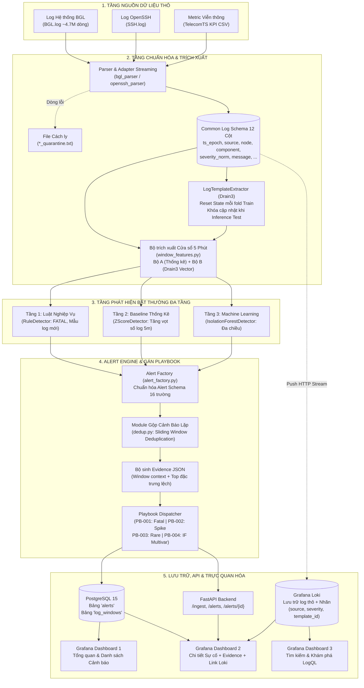

# KIẾN TRÚC HỆ THỐNG VÀ LUỒNG DỮ LIỆU ĐẦU–CUỐI (SYSTEM ARCHITECTURE & ADR)
**Mã Task:** K4 (P0) — Leader & Architect  
**Đề tài:** N3.10 – Phát hiện bất thường trong log và dữ liệu vận hành mạng  
**Đơn vị:** HKDN UTH – VNPT NET  
**Ngày phê duyệt:** 20/11/2026  
**Trạng thái:** ✅ ĐÃ DUYỆT (Chốt stack công nghệ cho toàn nhóm)

---

## 1. Tổng quan Kiến trúc Hệ thống

Hệ thống được thiết kế theo kiến trúc **Microservices dạng Modular Pipeline** triển khai cục bộ qua **Docker Compose** trên máy trạm (8–16 GB RAM), phục vụ giám sát và phát hiện bất thường tự động theo định hướng **AIOps & Observability**.

Hệ thống bao gồm 4 khối chức năng chính:
1. **Data Ingestion & Ingestion Pipeline:** Tiếp nhận log/metric từ đa nguồn (BGL, OpenSSH, TelecomTS), chuẩn hóa theo **Common Log Schema 12 trường (K2)**.
2. **Template Mining & Feature Extraction:** Phân tích cú pháp mẫu log động bằng **Drain3** (với cơ chế *Reset State* chống rò rỉ), tổng hợp cửa sổ thời gian 5 phút (*5-minute tumbling windows*) sinh bộ đặc trưng A (thống kê phân phối) và bộ đặc trưng B (tần suất template).
3. **Multi-layer Anomaly Detection Core:** 3 tầng phát hiện bổ trợ nhau:
   - **Tầng 1 - Luật nghiệp vụ (Rule-based):** Bắt lỗi nghiêm trọng tức thời (FATAL, panic) và mẫu log hiếm/mới lạ.
   - **Tầng 2 - Baseline thống kê (Z-score / MAD):** Phát hiện bão log, tăng đột biến tần suất lưu lượng trong cửa sổ 5 phút.
   - **Tầng 3 - Máy học không giám sát (Isolation Forest):** Phát hiện bất thường tương quan đa chiều trong không gian đặc trưng.
4. **Alert Engine, Observability & Visual UI:**
   - **Alert Factory & Deduplication (K5–K7):** Chuẩn hóa cảnh báo theo **Alert Schema 16 trường (K3)**, gộp cảnh báo lặp, trích xuất bằng chứng giải thích (**Evidence**) và gán mã hướng dẫn điều tra (**Playbook PB-001..PB-004**).
   - **Lưu trữ & Truy vấn:** **PostgreSQL** lưu bảng `alerts` & `log_windows`; **Grafana Loki** lưu log thô đã chuẩn hóa hỗ trợ truy vấn LogQL tốc độ cao.
   - **Trực quan hóa:** **Grafana** (3 Dashboard chuyên dụng) và **FastAPI Backend Service**.

---

## 2. Sơ đồ Kiến trúc & Luồng dữ liệu Đầu–Cuối (End-to-End Pipeline)

---

## 3. Kiến trúc Hạ tầng Docker Compose (Tech Stack)

Toàn bộ hệ thống được container hóa qua `docker-compose.yml`, kiểm soát tài nguyên để chạy mượt mà trên môi trường máy trạm cá nhân:

| Dịch vụ (Service) | Công nghệ / Image | Cổng (Port) | Vai trò & Trách nhiệm chính | Phụ trách |
|---|---|:---:|---|---|
| **Database** | `postgres:15-alpine` | `5432` | Lưu trữ cấu trúc bảng `alerts` (khớp Alert Schema) và `log_windows` (chuỗi số liệu vẽ biểu đồ timeline). | Phước (P5) |
| **Log Store** | `grafana/loki:2.9.2` | `3100` | Lưu trữ log thô đã chuẩn hóa, đánh index theo label (`source`, `severity`, `template_id`), hỗ trợ LogQL. | Huy (H9) |
| **Visualization** | `grafana/grafana:10.2.0` | `3000` | Giao diện quan sát 3 Dashboard, cấu hình tự động provision Datasource (PostgreSQL + Loki). | Phước (P6–P8) |
| **Backend API** | `FastAPI (Python 3.10/3.14)` | `8000` | Cung cấp RESTful API nạp log (`/ingest`), truy vấn danh sách alert (`/alerts`), trả bằng chứng và playbook (`/alerts/{id}`). | Huy (H10–H11) |

---

## 4. Các Quyết định Kiến trúc Cốt lõi (Architecture Decision Records - ADR)

### ADR-01: Kiến trúc Lưu trữ Kép (Polyglot Persistence: Loki + PostgreSQL)
* **Bối cảnh:** Log hệ thống mạng có dung lượng rất lớn (BGL hàng triệu dòng), trong khi cảnh báo cần truy vấn quan hệ có cấu trúc (bộ lọc thời gian, mức độ nghiêm trọng, phân trang, liên kết khóa ngoại).
* **Quyết định:** 
  - Dùng **Grafana Loki** để lưu trữ log text: Loki không đánh index toàn bộ văn bản mà chỉ đánh index nhãn metadata (`source`, `severity`, `template_id`), dung lượng nén cực nhỏ và tốc độ ghi log nhanh.
  - Dùng **PostgreSQL** để lưu bảng cảnh báo `alerts` và chuỗi chỉ số `log_windows`: Cho phép truy vấn SQL nhanh, dễ liên kết với Dashboard Grafana.
* **Hệ quả:** Tách biệt rõ ràng giữa lưu trữ dữ liệu thô và dữ liệu phân tích cảnh báo, tránh phình to cơ sở dữ liệu quan hệ.

### ADR-02: Phân tách Cửa sổ 5 Phút (5-Minute Tumbling Windows) cho Feature Engineering
* **Bối cảnh:** Dòng log xuất hiện không đều (có lúc hàng nghìn log/giây khi có sự cố, có lúc không có log nào suốt vài chục phút). Không thể đưa trực tiếp từng dòng log vào mô hình học máy.
* **Quyết định:** Áp dụng cửa sổ thời gian cố định **5 phút (300 giây)**. Tổng hợp các đặc trưng tổng số log, phân bố severity, và vector phân bố template Drain3 trong cửa sổ đó.
* **Hệ quả:** Chuẩn hóa bài toán phát hiện bất thường về dạng dữ liệu chuỗi thời gian đa chiều (multivariate time-series); đồng bộ được chu kỳ phát hiện giữa cả 3 detector.

### ADR-03: Nguyên tắc Cách ly Trạng thái (State Isolation & Zero Data Leakage)
* **Bối cảnh:** Cây tiền tố của Drain3 và các thuật toán học máy (Isolation Forest, Z-score) có thể cập nhật trạng thái khi gặp dữ liệu mới. Nếu tiếp tục học trên tập kiểm thử (Test), kết quả đánh giá sẽ bị sai lệch (nhìn trộm dữ liệu tương lai).
* **Quyết định:**
  - Bắt buộc khoảng đệm an toàn `buffer_gap_mins = 60` giữa Train và Test.
  - Ở mỗi fold/scenario, Drain3 và mô hình học máy **bắt buộc Reset State hoàn toàn** trên `train_df`. Khi sang pha `predict(test_df)`, Drain3 chuyển sang chế độ `inference_only = True` (khóa từ điển, không sinh cluster mới). Mọi template lạ chưa từng gặp trong tập Train đều bị gán `template_id = -1` và tính vào đặc trưng `f_n_new_tpl_lines`.
* **Hệ quả:** Đảm bảo tính khách quan tuyệt đối cho các công bố khoa học và báo cáo doanh nghiệp.

### ADR-04: Alert Deduplication bằng Cơ chế Sliding Time-Window
* **Bối cảnh:** Khi xảy ra sự cố mạng (ví dụ đứt cáp hoặc sập node mạng), hàng loạt cửa sổ liên tiếp sẽ liên tục kích hoạt cảnh báo, gây ra "bão cảnh báo" làm tê liệt đội ngũ kỹ sư NOC/SOC.
* **Quyết định:** Alert Engine sử dụng khóa `dedup_key = "{source}:{detector}:{alert_type}"`. Nếu cùng một loại cảnh báo xảy ra liên tiếp trong vòng 15–30 phút, hệ thống sẽ tự động gộp vào sự cố ban đầu, cập nhật `end_ts` và tăng bộ đếm số lần kích hoạt thay vì bắn nhiều thông báo mới.
* **Hệ quả:** Giảm thiểu cảnh báo rác, giữ cho bảng điều khiển Grafana trực quan và tập trung vào các sự cố trọng yếu.

---

## 5. Phân định Trách nhiệm Thực thi Giao diện Kỹ thuật

| Thành phần | Đầu vào | Đầu ra | Người sở hữu |
|---|---|---|---|
| **Common Log Schema** | Log thô (`.log`, `.txt`) | Parquet / CSV 12 trường | Kiệt thiết kế (K2), Huy triển khai (H1, H12) |
| **Drain3 & Windows** | Cột `message` + `ts_epoch` | `w_train.csv`, `w_test.csv` (Bộ A + B) | Huy (H3–H5) |
| **Detectors Interface** | `train_df`, `test_df` | `(y_pred, anomaly_scores)` | Huy (IF H7), Phước (Rule P1, Z-score P3) |
| **Alert Engine & Playbook**| Điểm bất thường từ Detectors | `alerts` record (JSON 16 trường) | Kiệt (K3, K5–K10) |
| **DB & Dashboards** | Alert record + Log thô | PostgreSQL tables + Grafana Panels | Phước (P5–P8, P9) |
| **Independent Testing** | Toàn bộ hệ thống | Báo cáo kiểm thử, Precision/Recall/F1/MCC | Khang (T1–T6) |

> **Ghi chú chuẩn hóa Hợp đồng Detectors Interface (Dòng 137):**
> - **Chiều điểm số (`anomaly_scores`):** Quy ước thống nhất toàn hệ thống là **điểm càng cao càng bất thường** (với Isolation Forest: `score = -score_samples()`, không coi là xác suất).
> - **Ngưỡng quyết định (`threshold`):** Lấy theo giá trị phân vị 99% (quantile 0.99) của `score` trên tập `train_df`.
> - **Phân loại nhãn cảnh báo (`alert_type`):**
>   - Nếu đặc trưng lệch nhất nằm trong nhóm template (`f_n_new_tpl_lines`, `f_n_rare_tpl_lines`, `f_tpl_*`) $\rightarrow$ gán `IF_TEMPLATE_DRIFT`.
>   - Ngược lại (lệch về tổng log, node, severity...) $\rightarrow$ gán `IF_MULTIVARIATE`.
> - **Cấu trúc Evidence:** Trả về top 3 đặc trưng có độ lệch chuẩn (z-score) lớn nhất so với phân phối tập Train: `{"name", "value", "train_mean", "train_std", "z"}`.
